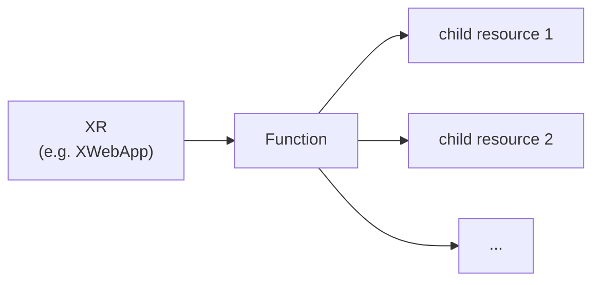
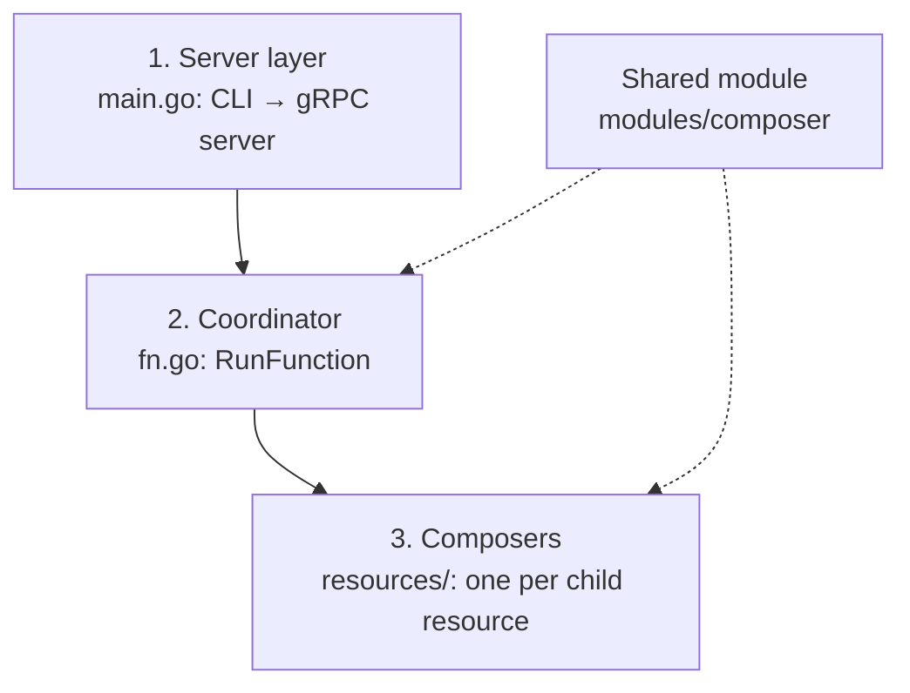
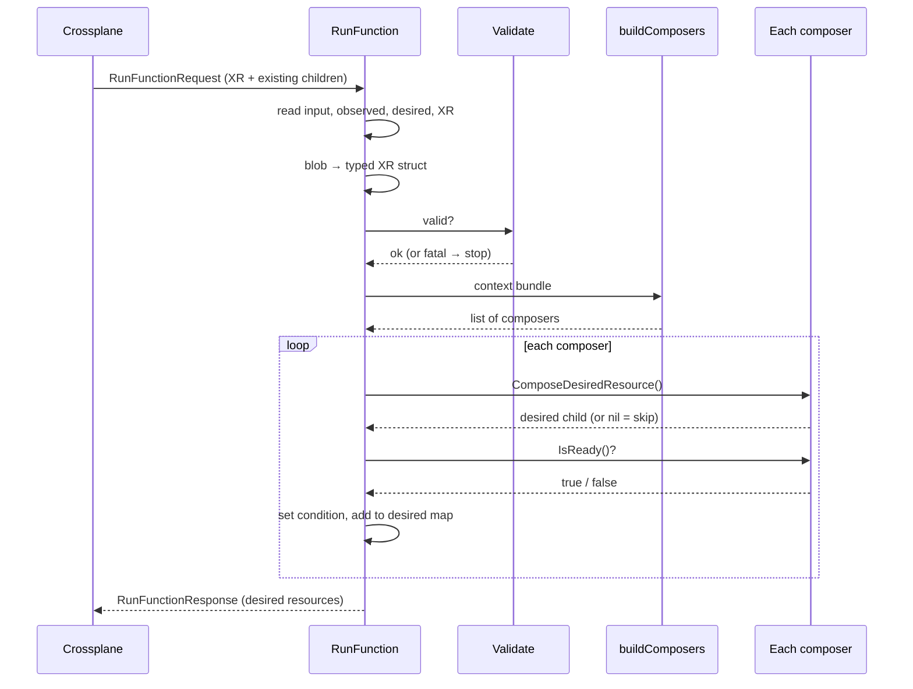

# How composition functions are designed in this repo

A generic map of how every function under `functions/` is built and how a request flows through it.
Read it once to learn the shape; after that, any function (`xwebapp`, `xtenantargo`, `xtenantentra`) looks familiar.

`XWebApp` is used as a small running example. For its full, detailed walkthrough see
[xwebapp/DESIGN.md](xwebapp/DESIGN.md).

Related docs: [CLI.md](CLI.md) (how a function starts), [SERVER.md](SERVER.md) (how it becomes a server),
[SchemeRegistration.md](SchemeRegistration.md) (blob ↔ typed struct).

---

## 1. What a function is

A **composition function** is a small gRPC server. Crossplane calls it on every reconcile with the
current state of a composite resource (XR) and gets back the **desired** child resources.



A function never creates anything itself. It **describes** what should exist; Crossplane creates it.

> Example: an `XWebApp` becomes a ServiceAccount, a Deployment, a Service and (optionally) an HTTPRoute.

## 2. Three layers

Every function has the same three layers, each with one job.



| Layer | Where | Job | Same for every function? |
| --- | --- | --- | --- |
| Server | `main.go` | Parse flags, register the handler, listen, block ([CLI.md](CLI.md), [SERVER.md](SERVER.md)) | Yes, almost identical |
| Coordinator | `RunFunction` in `fn.go` | Read the request, validate, hand work to composers, collect results | Same skeleton, different details |
| Composers | `resources/` | Each builds **one** child resource and knows when it is ready | No, this is the part that differs |

The shared code lives in [modules/composer](../modules/composer/composer.go), so functions don't copy it.

## 3. What is inside a function folder

| Path | Purpose |
| --- | --- |
| `main.go` | Server entry point (CLI + `function.Serve`) |
| `fn.go` | `Function` type, `RunFunction`, `buildComposers`, `init()` scheme registration |
| `resources/` | The composers, plus a `types.go` that fills in the shared generics |
| `input/` | The function's own input type (platform defaults), with generated schema |
| `package/` | Crossplane package metadata (`crossplane.yaml`) |
| `example/` | A sample XR, composition and functions manifest to try it out |
| `fn_test.go` | Tests |
| `Dockerfile` | Builds the container image Crossplane runs |

The XR's Go type lives separately in [types/](../types/) (for example [types/xwebapp](../types/xwebapp/types.go))
so it can be shared.

## 4. The request flow

The same sequence runs in every function.



1. **Read the request:** input (defaults), observed children, desired map so far, the XR.
2. **Convert** the untyped XR blob into a typed struct.
3. **Validate** rules the XRD schema can't express. On failure, report and stop.
4. **Build the context bundle and the composers.**
5. **Loop:** each composer builds its desired child and says whether the existing one is ready.
6. **Return** the full desired map in the response.

Errors are reported **inside the response** (`response.Fatal(...)`, then `return rsp, nil`) so they show
up on the XR. A returned Go `error` would mean the gRPC call itself failed.

## 5. The building blocks

### The context bundle

One struct holding everything a composer needs, passed to all of them.

```go
type FunctionContext[XR any, D any] struct {
    Observed         map[resource.Name]resource.ObservedComposed // all existing children, untyped
    FunctionResponse *fnv1.RunFunctionResponse                   // handle to the response (for fatal errors)
    XR               XR                                          // the typed XR
    Defaults         D                                           // the function's input
    Log              logging.Logger
}
```

It is **generic**: the shared module leaves the XR type (`XR`) and the defaults type (`D`) open.
Each function fills them in for itself with a type alias, which makes the bundle specific to that function:

```go
// resources/types.go in xwebapp
type XContext  = composer.FunctionContext[*xwebapp.XWebApp, *inputv1beta1.Input]
type XComposer = composer.BaseComposer   [*xwebapp.XWebApp, *inputv1beta1.Input]
```

Composers can then write `f.XR.Spec.Template` or `f.Defaults.Gateway` with no casting.

### The composer contract

Every composer implements the same small interface, so the loop treats them all alike:

| Method | Question it answers |
| --- | --- |
| `ComposeDesiredResource()` | "What should this child look like?" (`nil` = don't create it) |
| `IsReady()` | "Is the existing child healthy yet?" |
| `GetConditionType()` | "What do I call this in the XR's status?" |
| `GetConnectionDetails()` | "Which connection details does this child contribute?" |

### The shape of one composer

```go
type Deployment struct {
    XComposer                           // shared base: the context bundle, ResourceName, ConditionType, common methods
    ObservedResource *appsv1.Deployment // this composer's own existing child (typed), or nil on first run
}
```

| Field | What it is | Differs per composer? |
| --- | --- | --- |
| `XComposer` | Shared base from `BaseComposer`: the same context bundle, the resource name, the condition type, common methods | No, the same for all |
| `ObservedResource` | Only this composer's existing child, typed | Yes, specific to this one |

The constructor (`NewDeployment(f)`) picks its own child out of the bundle's `Observed` map (all children,
untyped) and converts it, so `IsReady()` can read typed fields such as `Status.Conditions`.

## 6. Rules every composer follows

- **`nil` means "do not create this".** For example the Service is skipped when there are no ports.
- **A not-ready child is still added** to the desired map. Readiness only affects the condition and the
  `Ready` flag; dropping the child would make Crossplane delete it.
- **Platform-owned fields win.** The composer overwrites them; the API server validates the rest.
- **Register every Go type you convert** in `init()` ([SchemeRegistration.md](SchemeRegistration.md)).

## 7. Small example: XWebApp

| Layer | In `xwebapp` |
| --- | --- |
| Server | `main.go` serves `Function` on `:9443` |
| Coordinator | `RunFunction` in [fn.go](xwebapp/fn.go) |
| Bundle | `XContext` in [resources/types.go](xwebapp/resources/types.go) |
| Composers | `ServiceAccount`, `Deployment`, `Service`, `HTTPRoute` in [resources/](xwebapp/resources/) |
| Validation | `Validate` in [resources/utils.go](xwebapp/resources/utils.go) |

For an XWebApp named `foo`, `buildComposers` returns four composers whose resources are named
`xwebapp-serviceaccount-foo`, `xwebapp-deployment-foo`, `xwebapp-service-foo` and `xwebapp-httproute-foo`.
`Service` and `HTTPRoute` return `nil` when there is nothing to expose.

## 8. Cheat sheet

| I want to... | Do this |
| --- | --- |
| Add a child resource to an existing function | Add a composer file in `resources/` and call its constructor in `buildComposers` |
| Add a validation rule | Extend that function's `Validate` |
| Change when a child counts as ready | Edit that composer's `IsReady()` |
| Add a platform default | Add it to the function's `input/` type and read it via `Defaults` |
| Support a new Kubernetes type | Register it in `init()` |
| Create a new function | Copy an existing function folder, fill in its own XR type and input type in `resources/types.go`, write its composers |

## Glossary

| Term | Meaning |
| --- | --- |
| **XR** | Composite resource: the high-level resource a developer applies (for example `XWebApp`) |
| **Composed resource** | A child resource Crossplane manages for the XR |
| **Observed** | What currently exists in the cluster |
| **Desired** | What the function says should exist |
| **Composer** | A struct that knows how to build and check one child resource |
| **Context bundle** | One struct passed to every composer with everything it needs |
| **Blob / unstructured** | The untyped `map[string]interface{}` form of a resource |
| **Condition** | A status entry on the XR (for example `DeploymentReady`) |
| **Reconcile** | One round of Crossplane comparing observed to desired and calling the function |
