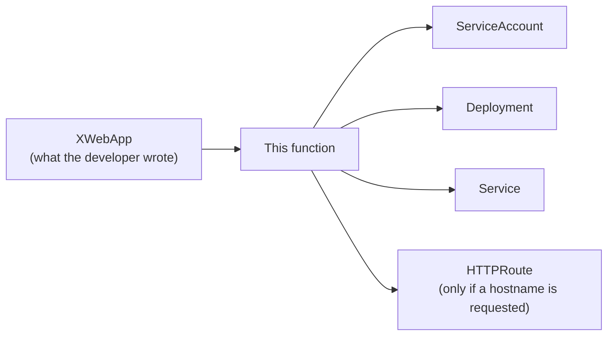
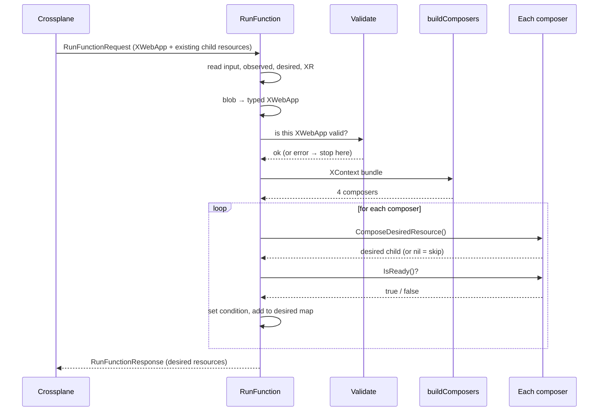
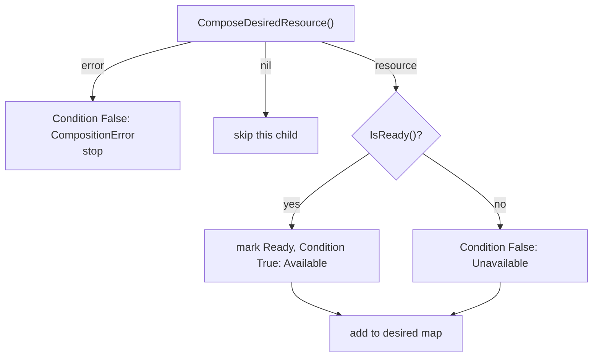

# How the XWebApp function is wired

Read this MD top to bottom once, then use the [cheat sheet](#cheat-sheet-where-do-i-change-things) later.

Related docs: [SERVER.md](../SERVER.md) (how the process becomes a server),
[SchemeRegistration.md](../SchemeRegistration.md) (blob ↔ struct), [CLI.md](../CLI.md) (how it starts).

---

## 1. The big picture

A developer applies a small **XWebApp** (an XR, "composite resource"). Crossplane asks this
function: *"given this XWebApp, which child resources should exist?"* The function answers with a
list of desired resources, and Crossplane creates and updates them.



The function never creates anything itself. It only **describes** what should exist (the desired
state). Crossplane does the creating.

## 2. The cast

Think of one **coordinator** and four **specialists**.

| Role | Where | Job |
| --- | --- | --- |
| Coordinator | `RunFunction` in [fn.go](fn.go) | Reads the request, hands work out, collects the results |
| Bundle of inputs | `XContext` in [resources/types.go](resources/types.go) | One struct that holds everything a composer needs to do its job: the XWebApp, the platform defaults, what already exists, and a way to report problems. Each composer receives the same bundle and picks out what it needs |
| Specialists ("composers") | [resources/](resources/) (`ServiceAccount`, `Deployment`, `Service`, `HTTPRoute`) | Each one builds **one** child resource and knows when it is ready |
| Shared toolbox | [BaseComposer](../../modules/composer/composer.go) | Code every specialist shares (name, condition type, typed → blob conversion) |
| Rulebook | `Validate` in [resources/utils.go](resources/utils.go) | Rejects bad XWebApps before any work starts |

## 3. The flow, step by step



In [fn.go](fn.go), `RunFunction` does these in order:

1. **Read the request.**
   - `GetInput`: the function's defaults (tolerations, gateway).
   - `GetObservedComposedResources`: children that already exist.
   - `GetDesiredComposedResources`: the desired map to add to, holding what earlier functions in the composition pipeline already asked for (empty if this is the first or only step).
   - `GetObservedCompositeResource`: the XWebApp itself.
2. **Convert blob → typed struct.** `FromUnstructured` copies the untyped XWebApp into `xw`, a typed
   `xwebapp.XWebApp`, so the code can write `xw.Spec.Template`.
3. **Validate.** `resources.Validate(&xw)` checks rules the XRD schema can't express (for example
   every port must be named). On failure it sets a condition, reports the error and stops.
4. **Build the bundle and the composers.** `buildComposers(XContext{...})` creates the four composers.
5. **Loop over the composers.** For each one, build its desired resource, check readiness, record a
   condition (details in [section 5](#5-the-loop-what-happens-to-each-composer)).
6. **Return.** `SetDesiredComposedResources` writes the whole map into the response.

If any step fails, the function calls `response.Fatal(...)` and returns `rsp, nil`. The error
travels **inside the response** so it shows up on the XWebApp. A Go `error` would mean the gRPC call
itself broke.

## 4. The bundle: `XContext`

`XContext` is one struct holding everything a composer might need. It is passed to every composer
instead of five separate arguments.

| Field | Contains | Used for |
| --- | --- | --- |
| `Observed` | children that already exist | each composer finds its own and checks `IsReady()` |
| `FunctionResponse` | a handle to the response `RunFunction` is building | a composer uses it only to report a fatal error; its real output is the `DesiredResource` it returns |
| `XR` | the typed XWebApp (`&xw`) | reading `spec` and metadata to build each child |
| `Defaults` | the function's input | platform values such as tolerations and gateway |
| `Log` | logger with XR fields attached | structured logging |

`XContext` is a short name for the shared, generic `FunctionContext` with its two blanks filled in. The shared module leaves the XR type and the defaults type open so our functions can reuse it; here we fill them in for this function, making the bundle specific to `XWebApp`:

```go
type XContext = composer.FunctionContext[*xwebapp.XWebApp, *inputv1beta1.Input]
//                                        └─ XR: the typed XWebApp
//                                                          └─ Defaults: this function's Input
```

Because the blanks are filled in, `XR` is a typed `*xwebapp.XWebApp` and `Defaults` is a typed `*inputv1beta1.Input`. Composers can write `f.XR.Spec.Template` or `f.Defaults.Gateway` with no casting.

## 5. The loop: what happens to each composer

Every composer satisfies the same small interface
([ComposableResource](../../modules/composer/composer.go)), so the loop treats them all alike:

| Method | Question it answers |
| --- | --- |
| `ComposeDesiredResource()` | "What should this child look like?" (may return `nil` = skip) |
| `IsReady()` | "Is the existing child healthy yet?" |
| `GetConditionType()` | "What do I call this in the XR's status?" (e.g. `DeploymentReady`) |

Per composer, the loop in `RunFunction` does:



**Caveats:**

- **`nil` means "do not create this".** `Service` returns `nil` when no container declares a port;
  `HTTPRoute` returns `nil` when no hostname is requested. `ComposeDesiredResourceFrom` turns a
  typed-nil pointer into `nil` so no empty phantom resource is emitted.
- **A not-ready child is still added.** Readiness only controls the condition and the `Ready` flag.
  The child must stay in the desired map either way, or Crossplane would delete it.

## 6. Anatomy of one composer

Every composer file in [resources/](resources/) follows the same shape. `Deployment` as the example:

```go
type Deployment struct {
    XComposer                           // shared base: the XContext bundle, ResourceName, ConditionType, common methods
    ObservedResource *appsv1.Deployment // this composer's own existing child (typed), or nil on first run
}
```

**Why two things, and how they differ:**

| Field | What it is | Why it's here |
| --- | --- | --- |
| `XComposer` | The shared base from `BaseComposer`. It holds the same `XContext` bundle every composer gets, plus `ResourceName`, `ConditionType` and the common methods | Every composer needs the same inputs and helpers, so they are written once and embedded |
| `ObservedResource` | Only this composer's child, as a typed struct | `NewDeployment` picks it out of the bundle's `Observed` map (all children, untyped) so `IsReady()` can read typed fields like `Status.Conditions` |

Rule of thumb: `XComposer` is **the same for every composer**; `ObservedResource` is **specific to this one**.

| Piece | What it does |
| --- | --- |
| `NewDeployment(f)` | Computes the name `xwebapp-deployment-<xr name>`, loads the observed Deployment from `f.Observed` (typed), stores `ConditionType: "DeploymentReady"` |
| `ComposeDesiredResource()` | Calls `createResource()`, then the shared `ComposeDesiredResourceFrom(...)` |
| `createResource()` | Builds the typed `*appsv1.Deployment` from `XR` and `Defaults` |
| `IsReady()` | Looks at `ObservedResource` (for a Deployment: the `Available` condition is true) |

What "ready" means per child:

| Child | Ready when | Created when |
| --- | --- | --- |
| ServiceAccount | it exists | always |
| Deployment | `Available` condition is true | always |
| Service | it has a ClusterIP | at least one container port exists |
| HTTPRoute | a parent Gateway has `Accepted` it | a hostname **and** a port named `http` exist |

The Deployment is built from the developer's pod template plus **platform-owned fields**
(service account, tolerations, topology spread, selector labels, default 2 replicas). The platform
wins on those fields; the API server validates the rest.

## 7. Worked example

The developer applies an XWebApp named `foo` with one container port named `http` and a hostname.

1. `Validate` passes (the port is named, and `http` exists for the hostname).
2. `buildComposers` returns four composers, named:
   - `xwebapp-serviceaccount-foo`
   - `xwebapp-deployment-foo`
   - `xwebapp-service-foo`
   - `xwebapp-httproute-foo`
3. First reconcile: nothing is observed, so every `IsReady()` is `false`. All four children are
   added to desired, with conditions `...Ready=False (Unavailable)`.
4. Crossplane creates them. On later reconciles `Observed` is filled in, `IsReady()` flips to `true`
   one by one, and the conditions become `True (Available)`.
5. Remove the hostname: `HTTPRoute` returns `nil`, is no longer desired, and Crossplane removes it.

## Cheat sheet: where do I change things?

| I want to... | Go to |
| --- | --- |
| Add a new rule that rejects bad input | `Validate` in [resources/utils.go](resources/utils.go) |
| Change how the Deployment is built | `createResource()` in [resources/deployment.go](resources/deployment.go) |
| Change when a child counts as ready | that child's `IsReady()` |
| Add a new child resource | copy a composer file in [resources/](resources/), then add `NewXxx` to `buildComposers` in [fn.go](fn.go) |
| Add a new platform default | the `Input` type in [input/](input/) and read it via `Defaults` |
| Register a new Kubernetes type | `init()` in [fn.go](fn.go) (see [SchemeRegistration.md](../SchemeRegistration.md)) |

To **add a new child resource** the checklist is:

1. Create `resources/<kind>.go` with a struct embedding `XComposer` and an `ObservedResource`.
2. Write `New<Kind>(f XContext)`, `ComposeDesiredResource()`, `IsReady()` and `createResource()`.
3. Register the Go type in `init()` if it isn't already.
4. Call `New<Kind>` in `buildComposers` and add it to the returned slice.

## Glossary

| Term | Meaning |
| --- | --- |
| **XR** | Composite resource: the XWebApp the developer applies |
| **Composed resource** | A child resource Crossplane manages for the XR (Deployment, Service, ...) |
| **Observed** | What currently exists in the cluster |
| **Desired** | What the function says should exist |
| **Composer** | A struct that knows how to build and check one child resource |
| **Blob / unstructured** | The untyped `map[string]interface{}` form of a resource |
| **Condition** | A status entry on the XR (for example `DeploymentReady`) |
| **Reconcile** | One round of Crossplane comparing observed to desired and calling the function |
